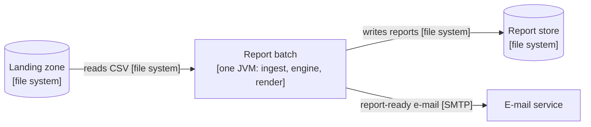
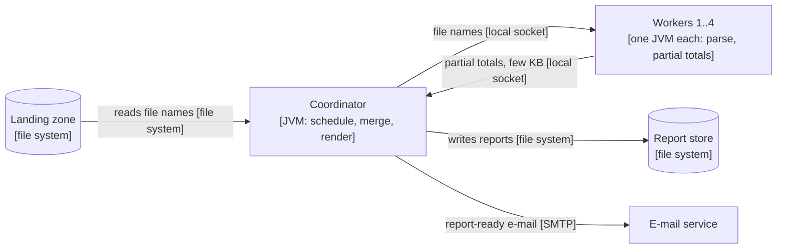
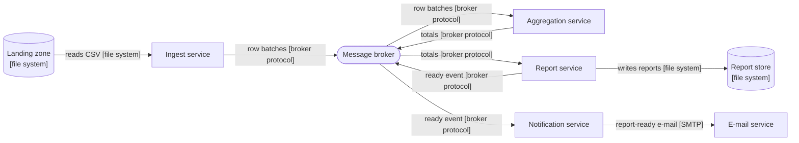

# ATAM-style evaluation: release 1 architecture

Date: 2026-10-20 · Evaluators: Rasmey Rithysak, Ouk Puthirith · Scenario ids refer to lab01/quality-scenarios.md

## Business drivers
- Report for month M on the morning of day 2 of M+1 (brief).
- Branch links fail now and then; a late file must not hold back the other branches (brief, QA-3).
- Branch managers see only their own branch; the finance director gets an e-mail when a report is ready (brief, QA-5).
- Head office asks about opening more branches and getting the report earlier (challenge scenario, QA-2).
- A team of two with about eight weeks of labs, Java 25 and Maven (lab constraint).

## Candidates

### A: modular monolith batch (ADR-0001)

### B: process pipeline

### C: event-driven microservices

## Scenario analysis
Rating: ++ strong, + good, 0 acceptable with extra work, − weak.

| Scenario | A: monolith batch | B: process pipeline | C: event-driven services |
|----------|-------------------|---------------------|--------------------------|
| QA-1 performance | ++ 4.9 s, 12 times under the 60 s limit; no serialization or hop. | + 7.4 s, 8 times under the limit; JVM start and socket traffic cost about 2.5 s more than A. | 0 7.9 s with 1 000 rows per event, but 60 s of broker time alone with one row per event. |
| QA-2 scalability | + 4th branch adds 33 %, just inside the 35 % target, but only on one machine. | ++ A 5th worker gives +17 %, and workers can move to other machines. | ++ Consumers scale out; on the same 8 cores it is +33 % like A. |
| QA-3 availability | 0 Late file is handled by the ADR-0002 policy, but a crash in one parser thread can stop the run unless ingest catches per-file errors. | + A crashed worker loses only its branch and the coordinator restarts it; the coordinator itself is a single point. | ++ The broker buffers late files and services restart alone; the broker is a new single point of failure. |
| QA-4 modifiability | ++ New format is a new renderer class plus one factory line, 2 files, one deployable. | + Same 2 files, but the coordinator must be redeployed with its workers. | + Same 2 files in the report service, but its message contract must stay compatible. |
| QA-5 security | 0 Access control lives in the web page; only SFTP and the web page face the network. | 0 Same as A, plus local sockets that must be bound to localhost. | − Broker and four services need authentication between them, a larger attack surface. |
| QA-6 testability | ++ Engine tests run on in-memory fixtures in one JVM, well under 30 s. | 0 Engine logic is still unit-testable; the pipeline needs a process harness for integration tests. | − Needs a broker or a fake for every test of the flow, and slower, flakier tests. |
| Cost and skills | ++ One repository, one deployable, JUnit and Maven the team already knows. | 0 Adds a socket protocol and process supervision, about 2 extra weeks of a 8-week plan. | − Broker operation, four deployables and container tooling; too much for two people. |

## QA-1 estimates (assumptions first)
Assumptions (all to be measured in a later lab; they are estimates today):
- N = 3.0 M rows, in 90 files (3 branches x 30 days), so 8 threads get a balanced load.
- Parse and validate cost c = 5 us per row on one core, so 15 s of single-core work.
- Merging partial results (2 s) and rendering (1 s) are serial: 3 s.
- 8 cores (A1). Amdahl's law: S(n) = 1 / ((1 - p) + p / n), T(n) = T1 / S(n), where p is the parallel share.

A, one JVM with 8 parser threads:
- T = 3 + 15 / 8 = 4.9 s. Check with Amdahl: T1 = 18 s, p = 15 / 18 = 0.83, S(8) = 1 / (0.17 + 0.10) = 3.69, T = 18 / 3.69 = 4.9 s. Meets (60 s).

B, 4 worker JVMs, each parsing a quarter of the files:
- JVM start 0.5 s (workers start in parallel, counted once), partial totals about 20 KB per worker over a local socket, 0.1 s in all.
- T = 0.5 + 15 / 4 + 0.1 + 3 = 7.35 s, about 7.4 s. Check: T1 = 18.6 s, p = 15 / 18.6 = 0.81, S(4) = 1 / (0.19 + 0.20) = 2.53, T = 18.6 / 2.53 = 7.4 s. Meets.

C, ingest, broker, aggregation, report services:
- One row per event: 3 000 000 / 50 000 msg/s = 60 s of broker time alone, before parsing or rendering. Fails.
- 1 000 rows per event: 3 000 events / 50 000 msg/s = 0.06 s. Serialization 0.5 us per row on each side: 1.5 s + 1.5 s. Parsing in 8 threads: 15 / 8 = 1.9 s.
- T = 1.9 + 1.5 + 0.06 + 1.5 + 2 + 1 = 7.9 s. Check: T1 = 21.06 s, p = 15 / 21.06 = 0.71, S(8) = 1 / (0.29 + 0.09) = 2.65, T = 21.06 / 2.65 = 7.9 s. Meets.

| Candidate | QA-1 time | Margin to 60 s |
|-----------|-----------|----------------|
| A | 4.9 s | 12 times |
| B | 7.4 s | 8 times |
| C, 1 000 rows per event | 7.9 s | 7.6 times |
| C, 1 row per event | over 60 s | fails |

QA-2, a 4th branch (4.0 M rows), assuming the serial work grows with the rows (3 s becomes 4 s):
- A: 20 / 8 + 4 = 6.5 s, which is +33 % against 4.9 s (target: 35 % or less).
- B with a 5th worker: 0.5 + 20 / 5 + 0.1 + 4 = 8.6 s, which is +17 % against 7.4 s.

## Sensitivity points
- S1: parse cost per row (c) affects QA-1 and QA-2 in A, B and C. In A, T = 3 M x c / 8 + 3 s gives 4.9 s at 5 us, 10.5 s at 20 us and 40.5 s at 100 us. B has only 4 workers, so at 100 us it takes 0.5 + 75 + 0.1 + 3 = 78.6 s and fails; slower parsing hurts B first.
- S2: event batch size in C affects QA-1 by a factor of 1 000: 60 s of broker time at one row per event against 0.06 s at 1 000 rows per event.
- S3: serial share of the run (merge and render, 3 s) affects QA-1 and QA-2 in A, B and C. More cores cannot help past it: in A, 16 cores give 15 / 16 + 3 = 3.9 s, only 19 % better than 8 cores. If merge and render grow faster than the row count, the 33 % of QA-2 in A passes the 35 % limit.
- S4: number of worker JVMs in B affects QA-1 and memory: 2 workers give 11.1 s, 4 workers 7.4 s, 8 workers 5.5 s, but each worker is a JVM with its own heap.

## Trade-off points
- T1: a broker between ingest and aggregation (C) buffers late files and lets services restart alone (+QA-3), but adds a network hop, serialization and an operated component (-QA-1, -cost, -QA-5 through a larger attack surface).
- T2: separate worker processes (B) isolate a crashing parser (+QA-3), but cost JVM start and socket traffic (-QA-1 by about 2.5 s) and need a process harness for integration tests (-QA-6).
- T3: one JVM (A) gives the fastest run and the fastest tests (+QA-1, +QA-6), but one fault can stop all branches unless ingest handles errors per file (-QA-3).

## Risks, non-risks, risk themes
Risk theme RT-1, one failing part stops the morning report (business driver: report on the morning of day 2 although branch links fail).
- R1 (A): an unhandled exception in one parser thread aborts the whole run. Mitigation: ingest catches errors per file and logs the file as rejected; tested with a fault-injection test.
- R2 (C): the broker is a single point of failure for every branch; if it is down at 06:00 there is no report at all.

Risk theme RT-2, growth beyond one machine (business driver: the chain opens more branches).
- R3 (A): the 4 GB heap (A7) is exceeded at 10 times the volume if the engine keeps all rows in memory (30 M rows x about 200 bytes = 6 GB). Mitigation: aggregate while streaming each file; keep only totals.
- R4 (A, B): the serial 3 s limits speed-up (S3) and QA-2 is only 2 points inside its limit.

Non-risks:
- NR1: parsing speed is not a risk for A: even at 20 us per row it needs 10.5 s of 60 s (S1).
- NR2: the idempotent re-run key (file name plus SHA-256) and the partial-report policy of ADR-0002 do not depend on the candidate, so the late-file handling works in A, B and C.
- NR3: adding an export format needs 2 files in every candidate because render sits behind the Strategy (QA-4).

## Recommendation
Confirm ADR-0001: release 1 stays a modular monolith batch job (A). A is best on QA-1 (4.9 s) and QA-6, ties B on QA-5 and is clearly cheapest for a team of two. Its weak point is QA-3, where C is stronger (++ against 0), but ADR-0002 already solves the late file without a broker: the partial report, the merge within 10 minutes and the idempotent re-run need only files and checksums. So C's main advantage costs too much for what it adds, and its QA-1, QA-5 and cost ratings are worse. No ADR-0003 is needed. We revisit when a month exceeds 10 M rows, when the measured QA-1 time goes above 30 s, or when R1 shows up in a real run; then B (workers on more machines) is the next step, not C.
