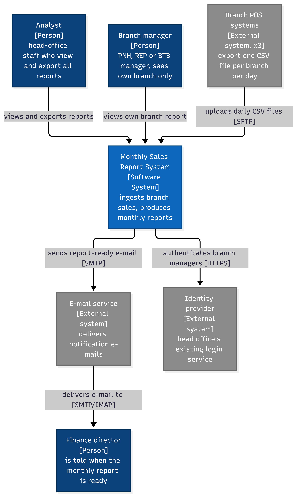
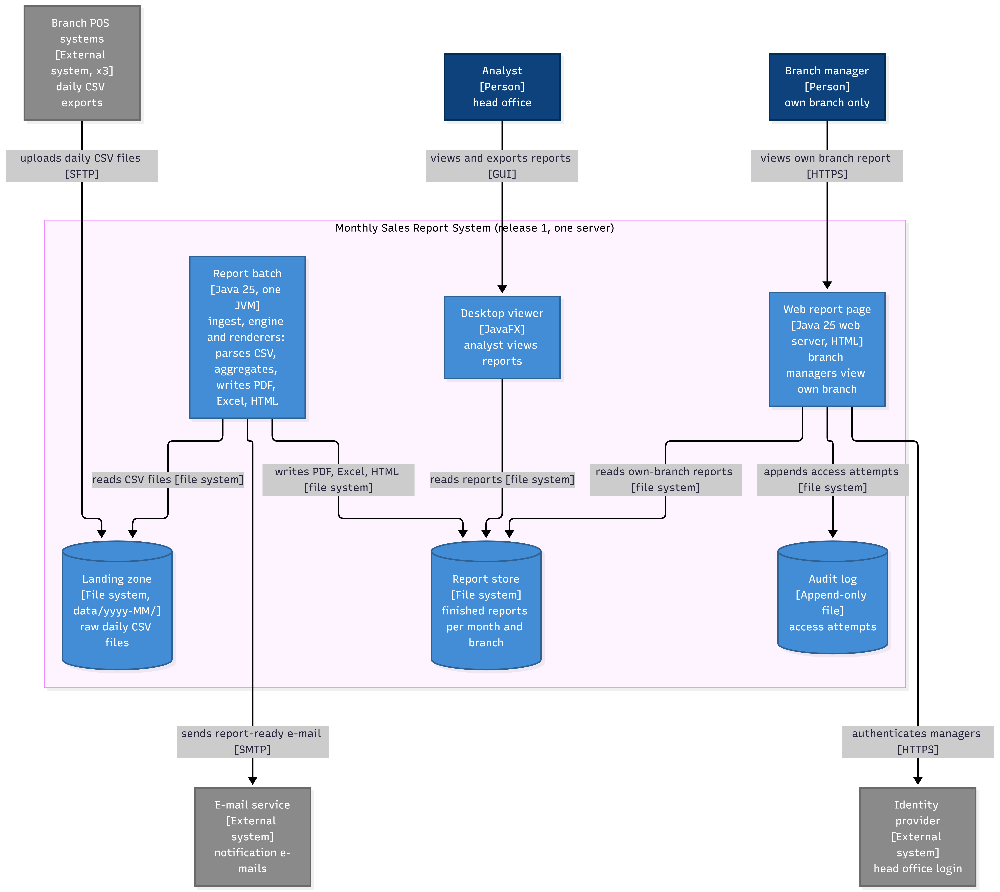

# C4 notes: Angkor Mart monthly sales report

## Context diagram (level 1)

The diagram deliberately does not show any internal structure of the system, the operations person who runs the jobs, or how the branches' files are produced. Its people and external systems are the ones that drive QA-3 (the branch links that deliver the files) and QA-5 (the identity provider that tells managers apart). Open question for the client: is the finance director only told by e-mail, or does he or she also need to open the report?

## Container diagram (level 2)

The diagram deliberately does not show classes, packages, the scheduler that starts the batch at 06:00, or how the containers are packaged onto the server. The report batch (ingest, engine and renderers in one JVM, see ADR-0001) serves QA-1 (3 M rows in 60 s) and QA-3 (late file merged, other branches published on time), and the web report page with its audit log serves QA-5 (a manager sees only their own branch). Open question for the client: do the branch POS systems already offer an SFTP upload, and who runs the SFTP server at head office?
