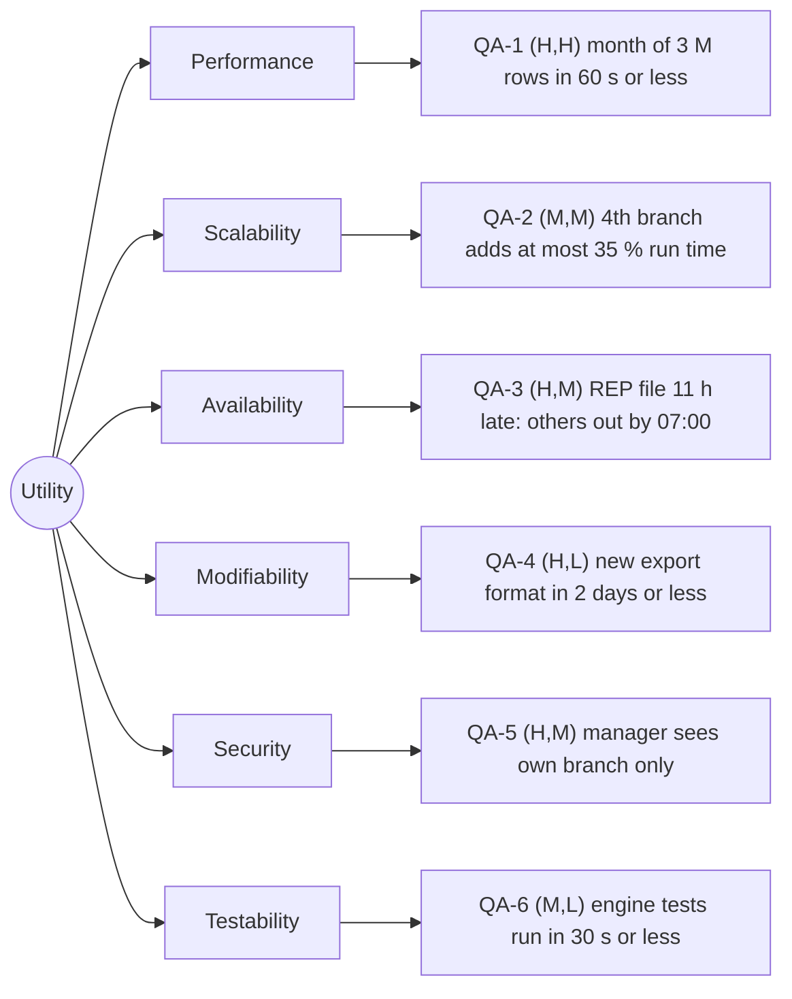

# Quality-attribute scenarios: Angkor Mart monthly sales report

## Stakeholders
- Head-office analyst: views and exports all reports; needs the report by the morning of day 2 of M+1.
- Branch manager (PNH, REP, BTB): sees only their own branch's report.
- Finance director: receives an e-mail when the report is ready.
- Operations person: runs and monitors the nightly and monthly jobs, handles late branch files.
- Development team: adds formats and branches, must be able to test every change.

## Scenarios
| ID | Attribute | Source | Stimulus | Artifact | Environment | Response | Response measure | Rank |
|----|-----------|--------|----------|----------|-------------|----------|------------------|------|
| QA-1 | Performance | Scheduler, 06:00 on day 2 of M+1 | Starts the report for a month of about 3 M rows | Report engine | Normal operation, 8-core server, 4 GB heap, files complete | Report files written (PDF, Excel and web page), "ready" event published | <= 60 s wall-clock from start to "ready" event, including all three formats, median of 5 runs after 2 warm-up runs | (H,H) |
| QA-2 | Scalability | Head-office manager | Chain opens a 4th branch (+33 000 rows/day, about +33 % volume) | Report engine, ingest | Normal operation, same server | Report is produced with no code change, only a new branch code in configuration | Run time grows <= 35 % versus 3 branches, median of 5 runs after 2 warm-up runs; 0 source files changed, checked with `git diff --stat` | (M,M) |
| QA-3 | Availability | REP branch internet link | The link is down and REP's file for the last day of M arrives at 10:00 on day 2 of M+1 (about 11 h after its 23:00 deadline) | Ingest job and report batch | Normal operation, report batch starts at 06:00 on day 2 of M+1 | PNH and BTB reports are published on time, REP is marked "partial", the late file is merged and the REP report is regenerated | PNH and BTB published by 07:00 in 5 of 5 fault-injection runs; late file merged within 10 min of arrival (file timestamps) | (H,M) |
| QA-4 | Modifiability | Head-office analyst | Asks for a new export format (for example JSON) | Render package | Development time, release 1 code base | Developer adds the format without touching ingest or engine | <= 2 person-days, taken from the developer's time log; <= 2 existing files changed (factory and registration line), counted with `git diff --stat` | (H,L) |
| QA-5 | Security | Branch manager of REP | Requests the PNH report URL while logged in | Web report page and report store | Normal operation | Request rejected, no PNH data returned, attempt written to the audit log | 0 of 100 scripted cross-branch requests return data; audit entry written within 1 s of each | (H,M) |
| QA-6 | Testability | Developer | Changes an aggregation rule and runs the tests | Report engine | Developer laptop, no network, no data files | All engine tests run on in-memory fixtures and report pass or fail | Engine tests finish in <= 30 s, measured by `mvn test` elapsed time after a successful compile and with dependencies already downloaded | (M,L) |

## Rank justifications
- QA-1 (H,H): the report is due in the morning and 3 M rows with BigDecimal arithmetic is the biggest load the system sees; missing it makes the system useless.
- QA-2 (M,M): a new branch is plausible but not planned; scaling by about a third needs parallel parsing and bounded memory but no new style.
- QA-3 (H,M): branch links fail now and then and head office still needs the report; handling partial data and late merges changes the data flow.
- QA-4 (H,L): PDF, Excel and web are all wanted and more will follow; a Strategy per format keeps the change local and cheap.
- QA-5 (H,M): branch managers must not see other branches; access control touches the UI, the store and the report layout.
- QA-6 (M,L): parsing and aggregation are pure functions, so testing without files or network is easy as long as the engine stays free of I/O.

## Assumptions
- A1: the report server has 8 cores and an SSD (to confirm with the client).
- A2: a month has 30 days and 33 000 rows per branch per day, so about 3 M rows (brief).
- A3: the 4th branch has the same daily volume as the others.
- A4: a late file arrives at most 24 h after the deadline; later files need a manual re-run.
- A5: branch managers log in through the head office's existing identity provider (to confirm with the client).
- A6: the audit log may be a plain append-only file in release 1.
- A7: the JVM for the report engine runs with a 4 GB heap (to confirm with the client).
- A8: the numeric targets (60 s, 35 %, 07:00, 10 min, 2 person-days, 30 s) are our proposals, to confirm with the instructor playing the client.

## Utility tree

## Architectural drivers
QA-1 (H,H), QA-3 (H,M), QA-5 (H,M)